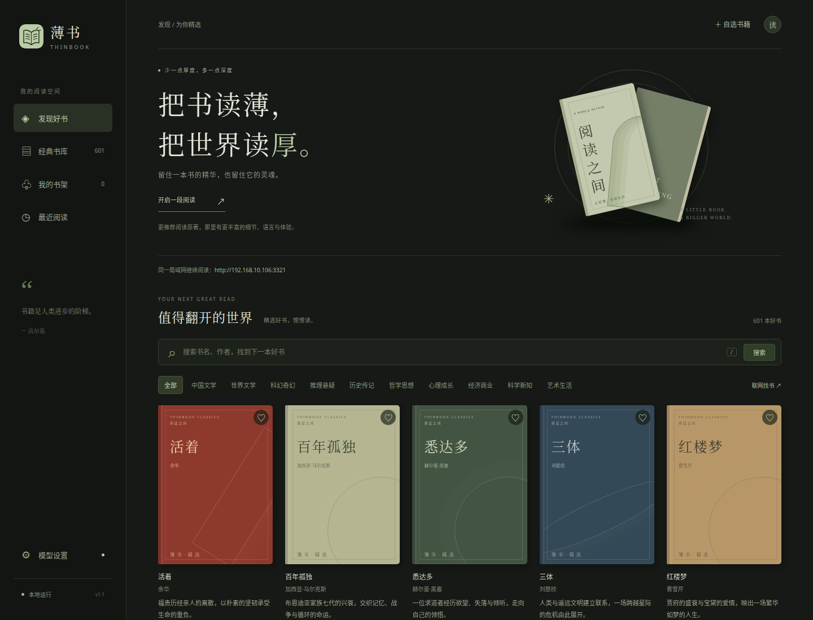
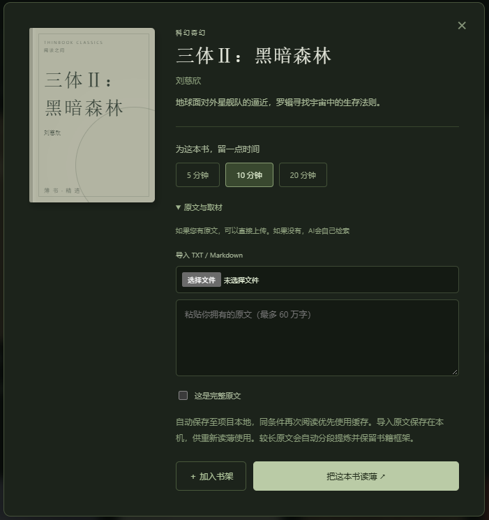
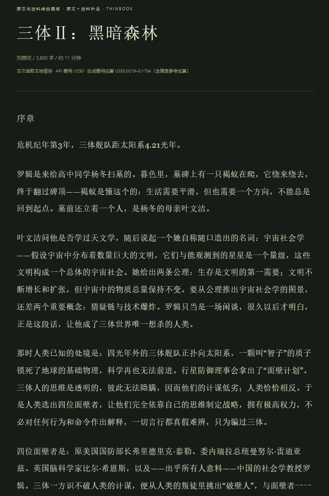

  

<strong>把书读薄，把世界读厚。</strong>

基于 DSH Web 的阅读插件，把一本书提炼成适合连续阅读的短文。

601 本好书 · 10 类书库 · 5 / 10 / 20 分钟 · 本地运行

  <a href="#快速开始">快速开始</a> ·
  <a href="#功能特征">功能特征</a> ·
  <a href="#界面预览">界面预览</a> ·
  <a href="docs/guide.md">使用指南</a>

## 功能特征

| 功能 | 体验 |
| --- | --- |
| 📚 经典书库 | 601 本书、10 类主题，支持书名、作者与系列查找 |
| ⏱️ 按时长读薄 | 5 / 10 / 20 分钟，保留故事脉络或核心论证 |
| 🔎 联网取材 | 搜索与抓取可靠资料，附可核验的参考来源 |
| 📄 原文导入 | 粘贴原文或导入 TXT / Markdown，区分节选与完整原文 |
| 🌿 阅读空间 | 收藏书架、阅读进度、字号调节与最近阅读 |
| 💾 本地缓存 | 同条件阅读优先用缓存，展示费用参考，支持 Markdown 导出 |
| 📱 局域网阅读 | 手机、平板共用主机服务，优先展示以太网的 `192.168.*` 地址 |
| ⚙️ 自动准备 | 检查 DSH ≥ 0.2.0-rc.2，缺失或过低时自动准备目标版本并重新注册插件；新版直接复用 |

## 快速开始

1. **下载解压**到可写目录。Windows 双击 `start.bat`；Linux 执行 `sh start.sh`。
2. **首次配置 Key**：Windows 双击 `configure.bat`；Linux 执行 `sh start.sh --dsh web`。在 DSH 中设置 DeepSeek API Key 和官方默认模型，再回到薄书刷新配置。
3. **挑一本书，开始读薄**：选择阅读时长，可按需导入原文。

页面独立监听 **`0.0.0.0:3102`**，本机地址为 <http://127.0.0.1:3102/>。端口占用时，直接绑定系统分配的空闲端口；启动日志和自动打开的页面使用实际端口。可通过 `THINBOOK_PORT` 或插件的 `port` 配置指定首选端口。

同一局域网设备使用 `http://主机局域网IP:实际端口/` 直接访问，无须登录或 token。继续复用 DSH 的模型与凭据；DSH 管理页面保留原有认证，仍可只监听本机。旧的 DSH 子路径保留兼容，日常启动自动打开独立端口。

已有 DSH Web？也可[安装为常驻插件](docs/guide.md#安装到-dsh-web-插件列表)。

## 界面预览

发现好书 · 分类浏览 · 系列查找

<table>
  <tr>
    <td width="50%"></td>
    <td width="50%"></td>
  </tr>
  <tr>
    <td align="center">留一点时间，读薄一本书</td>
    <td align="center">专注阅读，随时继续</td>
  </tr>
</table>

截图来自本地界面；阅读页使用明确标注的演示内容。

## 文档

[安装、配置与常见问题](docs/guide.md) · [实现、缓存与隐私](docs/implementation.md) · [系列书目](docs/catalog-series.md)

> 更推荐阅读原著。未提供完整原文时，薄书会标记为「资料提炼」或「节选缩写」。生成与联网取材会产生 API 费用，缓存读取不调用模型。

## 许可证

本项目采用 [MIT License](LICENSE)。第三方依赖与书籍原文等第三方内容遵循各自的许可与版权。
